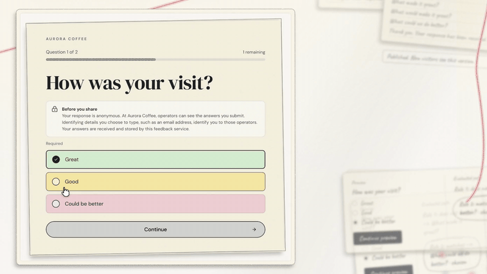
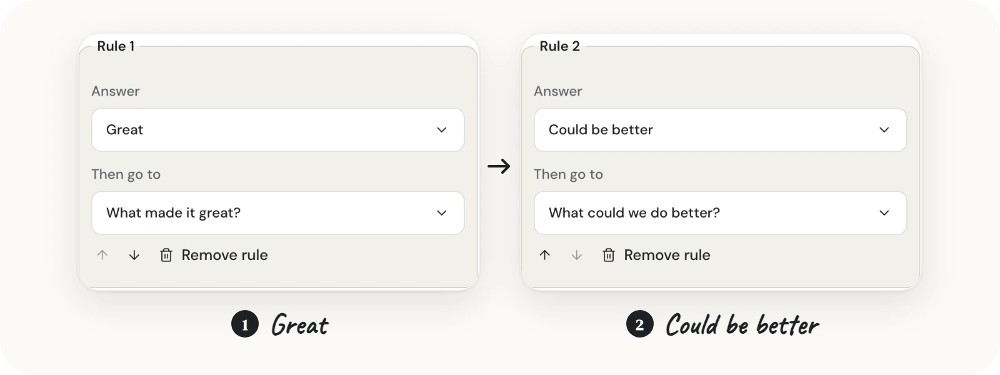
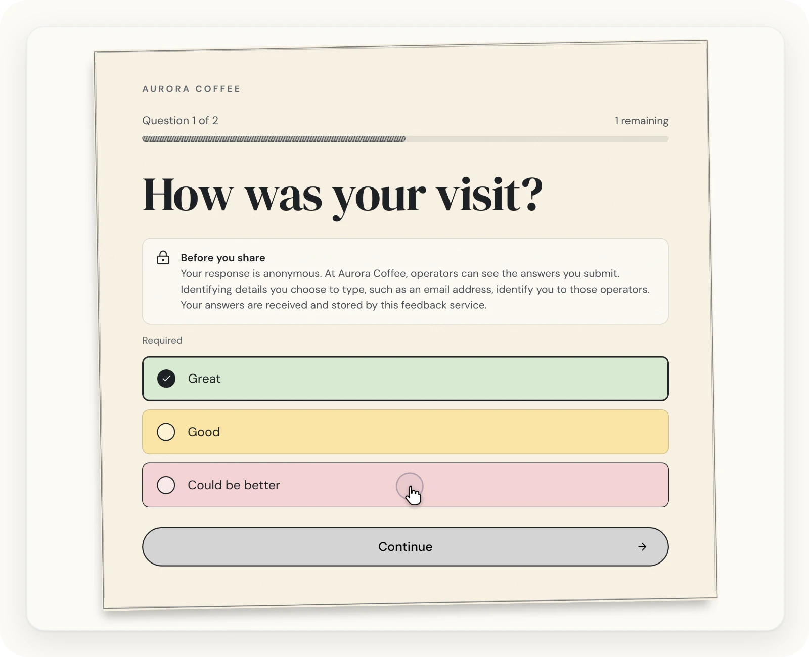
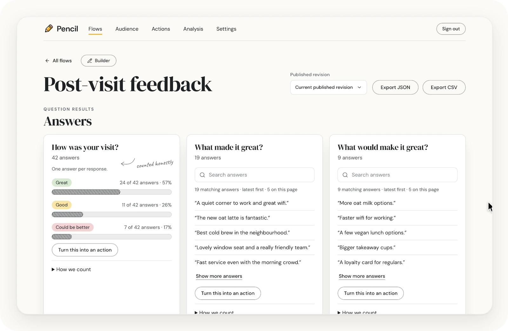

<p align="center">
  <a href="https://run-pencil.com">
    <picture>
      <source media="(prefers-color-scheme: dark)" srcset=".github/assets/banner-dark.webp">
      <source media="(prefers-color-scheme: light)" srcset=".github/assets/banner-light.webp">
      
    </picture>
  </a>
</p>

<p align="center"><a href="https://run-pencil.com">run-pencil.com</a> · <a href="https://justevery.com">Part of Just Every</a> · <a href="LICENSE">MIT licensed</a></p>

<p align="center">
  <a href="https://justevery.com/#vol-pencil"></a>
</p>
<p align="center"><a href="https://justevery.com/#vol-pencil"><b>Watch the full demo</b></a> · 50 seconds</p>

<p align="center">
  
</p>

<p align="center">
  <br>
  <sub>One question at a time, on a card your respondents can read.</sub>
</p>

<p align="center">
  <br>
  <sub>Results counted honestly, with every answer searchable.</sub>
</p>

# Pencil

Pencil is an editable form builder and feedback workspace with branching questions, published forms, results, branding, response email, embeds, a bounded Typeform JSON/CSV importer and a Google Forms CSV-first importer with an optional `forms.get` definition. To bring existing forms and historical responses into an editable draft, read the [moving-in guide](docs/guide/moving-in.md).

## Run it on your computer

Pencil runs on macOS, Linux or Windows with WSL2. The npm route requires **Node.js 22 or later, including npm, and Git**. Install Node from [nodejs.org](https://nodejs.org/en/download), then check `node --version` and `npm --version`. Node and npm must already be on your `PATH` to install and start rer. The installer command matches the [Run page](https://run-pencil.com/run); rer installs Pencil's pinned runtime and pnpm for its own commands, so you do not need global pnpm:

```sh
npm install -g @runeditrun/rer
git clone https://github.com/just-every/run-pencil.git pencil && cd pencil
rer dev
```

The global rer installation is the launcher. Inside this checkout, rer uses the exact `@runeditrun/rer` version in `package.json` and its lockfile; `rer --version` can show both versions. A different global launcher version does not change Pencil's pin. Keep that pin when following these instructions.

`rer dev` installs locked dependencies and prepares a local owner on first launch, without a separate setup command. Optional `rer setup --owner-email owner@example.com --owner-name Owner` prepares a local owner with your chosen details; reruns preserve existing owner, data and exact private settings. Dev prints its health-gated application URL and opens signed in: it prints `RER_SIGNED_IN` (who the browser will be) and `RER_OPEN`, a link for this computer that carries this checkout's private dev key in its fragment. Open it and the app signs you in as the local owner and takes you to **`/setup`** to finish your business name and time zone; finished setup enters the app. Open the private `RER_OPEN` link to continue as the owner in one click. Local mail is silently suppressed. Use `rer dev --as operator` or `--as signed-out` to select a different dev persona. The product name and title read **Pencil Dev**, without an injected bar or captured-mail inbox.

`rer demo` runs a disposable, signed-in **Pencil Demo** with the Aurora Coffee sample workspace. Public reads run for real; mail and third-party effects return success without sending. Demo state lives in `.rer/demo/` and is removed on stop; the owner's `.wrangler/state` is preserved.

Read the guide at `/docs` on your copy (its source is [docs/guide](docs/guide/overview.md)); `/` is the Lobby (**Finish setup** until first-run setup is confirmed, then **Sign in**), with `/pencil` redirecting there. An explicitly selected public landing flow in Settings keeps its existing respondent experience at `/`; Pencil's product page is the run site, run-pencil.com, built by `rer build --site`; published forms also keep their `/f/<slug>` links.

Keep `.dev.vars` private. Use `--port PORT` for an explicit loopback port. Stop dev with Ctrl-C or `rer dev --stop`.

To upgrade a local install to newer source, stop dev, export, pull, then run `rer install`, `rer setup` and `rer dev`; [Upgrading a local install](docs/guide/install.md#upgrading-a-local-install) has the steps. `rer dev` also applies pending migrations before it serves, and refuses to start with "run rer setup" if it cannot.

```sh
npx --no-install playwright install chromium --only-shell
rer verify
```

Verify runs the functional and high-stakes wall for source changes; it is separate from deploying an unchanged checkout. After intended source changes, stage them, inspect `node scripts/edition-authoring/cli.mjs changes`, run `node scripts/edition-authoring/cli.mjs lock`, commit with `sources.lock.json`, then run `npm run source:check`; without `lock` it fails with a stale lock.

Backups contain product data, including personal data, but exclude credentials, sessions and private settings. `rer export` and `rer import` operate on local state only. Hosted backup and restore use `node scripts/deployment-data-cli.mjs`, require all routes, schedules and other writers to be stopped, and restore into a separately provisioned migration-only empty D1 target. The script does not provision it; a normal owner-claimed deployment is not empty. Read [Backup and restore](docs/guide/backup.md) before planning a hosted move.

Reset prints and removes only inventoried local data, settings, owner, outbox and drafts; source, dependencies, exports and deployment receipts survive. Stop dev or preview before exporting, and export first to retain data:

```sh
mkdir -m 700 exports
rer dev --stop
rer preview --stop
rer export --output exports/installation.rer
rer reset --yes
rer import --input exports/installation.rer --yes
rer setup --owner-email owner@example.com --owner-name Owner
```

Import validates integrity and restores atomically into an empty destination without replaying mail. Archives retain the complete product graph, import custody, delivery history and operator identities; sessions, sign-in links, other credentials, captured mail and private settings are excluded, so everyone signs in again after a restore. These rer commands support local state; the separate maintained deployed D1 command is documented in [Backup and restore](docs/guide/backup.md).

```sh
rer deploy --dry-run --environment pencil-check
rer describe
rer check --profile first-party
```

The example `pencil-check` environment is a local dry run. Environment names must be at most 32 characters, start with a lowercase letter and contain lowercase letters or digits separated by single hyphens. Choose the intended name before deployment and retain it for later operations; see [Hosting on Cloudflare](docs/guide/hosting.md#check-then-deploy).

Managed hosting through RER sends production email through the RER relay; you need no SendGrid or Resend account or API key. Free and Assisted installations keep the ordinary SendGrid or Resend choices.

Direct Cloudflare deployment needs the intended Cloudflare account and your own production mail provider, verified sender and API key. Before deploying, find the account's Workers & Pages `workers.dev` subdomain: the default address is `https://pencil-production.<workers-subdomain>.workers.dev`. A named environment uses `https://pencil-<environment>.<workers-subdomain>.workers.dev`. rer looks up the real subdomain and sets the Worker's `APP_ORIGIN` to that generated address; you do not need to guess or supply it. Set `OWNER_EMAIL` to the hosted owner’s email and use `SEED_ADMIN_EMAIL="$OWNER_EMAIL" rer deploy` as documented in the [hosting guide](docs/guide/hosting.md): Pencil’s current declaration maps that input to its owner binding. Deploy claims the owner automatically; sign in at `/signin` on the printed hosted address and finish `/setup`. No manual setup-token step is needed. Dry run builds and validates with zero provider calls. Read [OPERATIONS.md](OPERATIONS.md), [RUN-LOCALLY.md](RUN-LOCALLY.md) and [SEED-COMMAND-CONTRACT.md](SEED-COMMAND-CONTRACT.md).

`rer signin --environment production` uses that deployment's Cloudflare credentials to issue a private, single-use link for its recorded owner without email. See [owner sign-in](docs/guide/hosting.md#sign-in-as-the-first-owner) for requirements. Keep the printed link private.

To delete a deployment and its data after making a [hosted backup](docs/guide/backup.md#back-up-a-deployed-database):

```sh
rer deploy --remove --yes --environment production
```

Removal deletes only resources recorded as created by rer in that environment and reads back that they are gone. Keep the private deployment receipt; removal is not a way to pause a Worker for backup.

Before **every release**, run `npm run verify:release` for unchanged capacity, maximum-size native memory, browser heap and load cases. These run outside CI and default verify. Publication inspection requires Gitleaks 8.30.1; `bash scripts/install-gitleaks.sh` installs the reviewed binary after checksum verification. CI uses the same installer and complete Base scanner. The maintained release dry run runs both commands:

```sh
rer release --repo . --ref HEAD --project just-every/pencil --repository https://github.com/just-every/run-pencil --onto https://github.com/just-every/run-pencil#main --tag vVERSION --dry-run --output ../pencil-release
```

Require a complete scan with zero findings and reviews, without exclusions or an allowlist. Hosted installation, real-export validation, tags, public publication and site listing require the owner. Draft rewrites require explicit acceptance, analysis outcomes appear on the Analysis page, and each operator can choose Immediately, Daily or Off per flow. All contract clauses are active. These paths have local behavioral proof; live provider and inbox receipts remain separate. CONTRACT.md and BASELINE.md record product guarantees.

Optional managed delivery emits the actual Worker, assets, setup descriptor and ordered migrations. Signed admission creates one native owner in an empty installation; initialized stores reject further claims. The editor requires a current native owner session and revokes on sign-out. Hosted acceptance remains with the owner.
